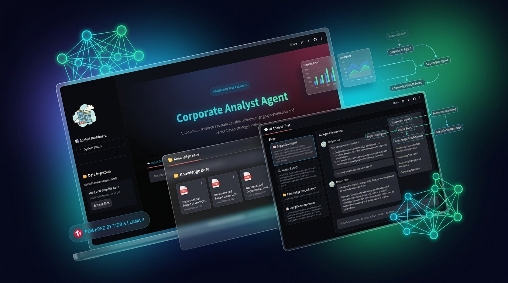
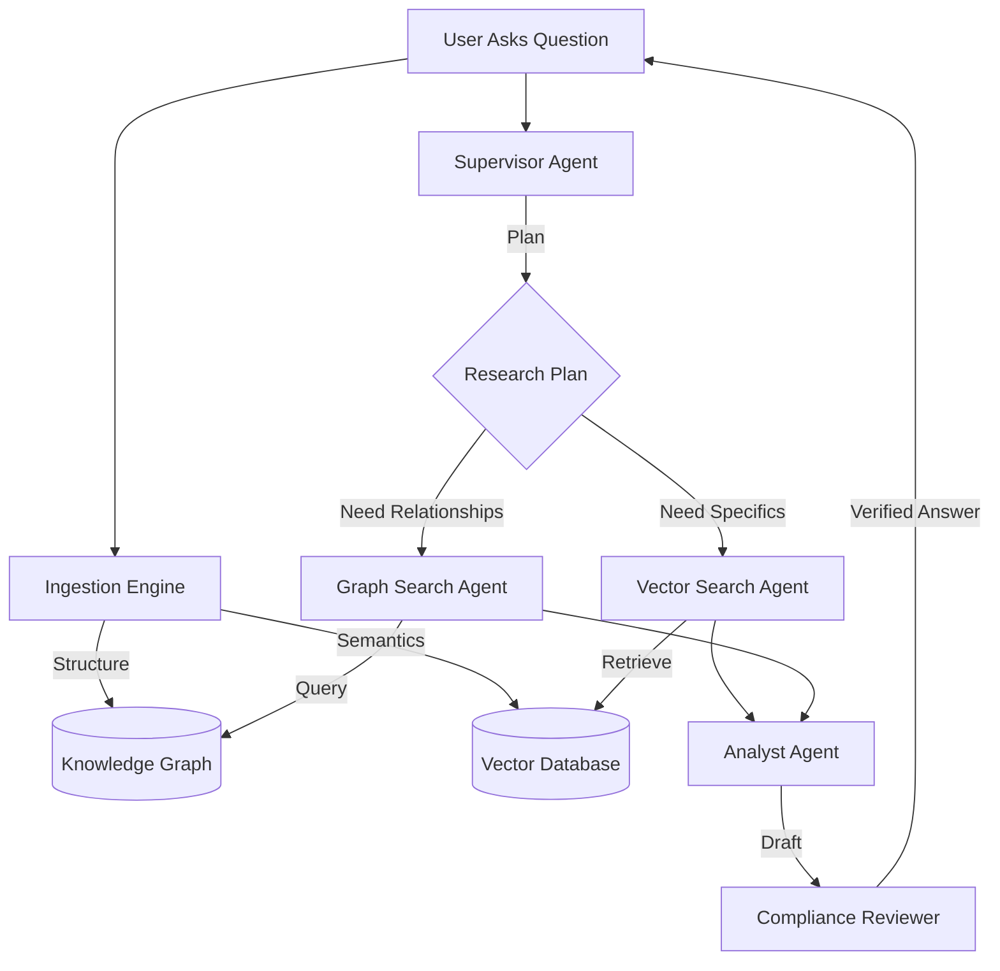

# Corporate Analyst Agent

> **An Autonomous AI Research Assistant specifically designed for Corporate Strategy and Analysis.**  
> Powered by **Llama 3**, **LangGraph**, and **TiDB Serverless**.

## Overview

The **Corporate Analyst Agent** is an AI system capable of performing deep research across complex corporate documents. Unlike traditional chatbots that simply predict the next word, this agent uses a **Cognitive Architecture** to plan, research, and verify information.

It combines **Knowledge Graphs** (to understand entities such as *CEO*, *Competitor*, and *Acquisition*) with **Vector Search** (to understand semantic context), ensuring that every answer is grounded strictly in the provided data.

## The Problem Solved

Standard Retrieval-Augmented Generation (RAG) systems often fail on complex corporate queries such as *"How does the new regulation affect the subsidiary's risk profile?"* because they rely solely on keyword or direct semantic chunk matching without understanding entity relationships.

**This Agent addresses this challenge by:**
1. **Extracting Structure**: Automatically constructing a graph of relationships from ingested documents.
2. **Multi-Step Reasoning**: Decomposing complex queries into sub-tasks (e.g., "Find subsidiary", "Check regulations", "Analyze risk").
3. **Hallucination Prevention**: Explicitly verifying facts with a compliance reviewer and refusing to answer if information is absent in source data.

## Key Capabilities

* **Autonomous Research**: The supervisor agent dynamically coordinates specialized sub-agents (Vector Searcher and Graph Searcher) to gather comprehensive evidence.
* **Knowledge Graph Extraction**: Automatically identifies and maps entities and relationships from corporate PDF filings.
* **Hybrid Intelligence**: Combines structured graph queries with unstructured vector similarity search for accurate corporate intelligence.
* **Real-Time Processing**: Optimized for speed and precision using Groq LPU inference.
* **Modern Experience**: Clean dark-mode interface built for analysts, featuring real-time agent thought streaming and managed knowledge repositories.

## System Architecture and Workflow

The system operates as a multi-agent orchestrated pipeline:

## Technology Stack

* **Large Language Model**: Meta Llama 3.1 (via Groq API)
* **Orchestration**: LangChain and LangGraph
* **Database**: TiDB Serverless (Unified Vector and Graph Store)
* **Embeddings**: HuggingFace (`sentence-transformers`)
* **Interface**: Streamlit (Python)

Live Application: [https://autonomous-corporate-research-analyst.streamlit.app/](https://autonomous-corporate-research-analyst.streamlit.app/)

---
*Built for the future of Corporate Intelligence.*